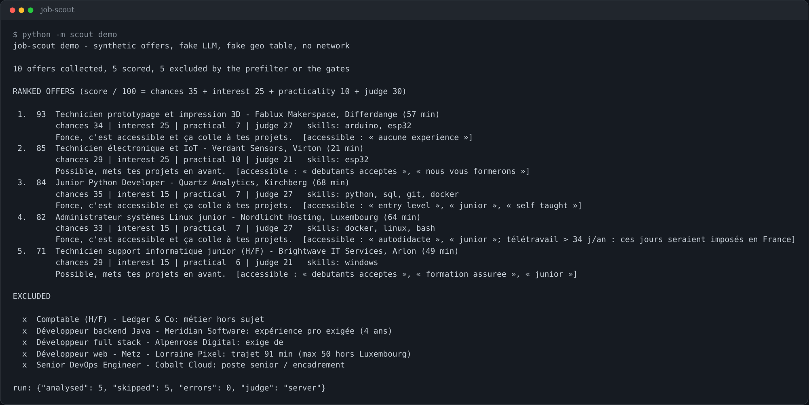
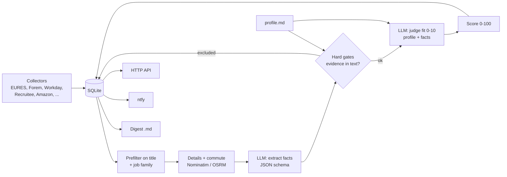

# job-scout

*[English version](README.md)*

Un agent personnel de recherche d'emploi : il collecte les offres de sources publiques, fait extraire les faits
de chaque offre par un LLM local, applique des filtres stricts, note ce qui reste et rédige un récapitulatif
quotidien. Python, SQLite, sans framework.



## Pourquoi cet outil

Je cherche un premier emploi en informatique dans une région frontalière (Luxembourg / Belgique / France). Les
sites d'offres renvoient des centaines d'annonces par jour, et la plupart demandent au moins trois ans
d'expérience, un diplôme ou l'allemand. Tout lire prend du temps, et demander directement à un LLM « est-ce un
bon poste pour moi ? » donne des réponses gonflées et peu fiables. job-scout découpe donc le problème :

1. le LLM ne fait qu'extraire des **faits** de l'offre (il ne voit jamais le profil du candidat, sinon il recopie
   ses compétences dans l'offre) ;
2. du code simple applique des **filtres stricts** (expérience exigée, langues, diplôme, trajet) et ne croit une
   affirmation du LLM que si la preuve se trouve dans le texte de l'offre ;
3. un second appel au LLM **juge l'adéquation** à partir du profil et des faits extraits ;
4. une note transparente sur 100 combine les deux, avec chaque critère visible.

## Fonctions

- Collecteurs de sources publiques : EURES (flux Luxembourg et Lorraine), open data du Forem (Wallonie), pages
  carrières Workday (JSON), Recruitee, Amazon jobs, et des collecteurs HTML à activer soi-même (jobs.lu, sitemap
  d'ictjob, deux pages d'employeurs).
- Préfiltre sur le titre, sans LLM (postes hors sujet, postes seniors, stages, annonces en allemand), et famille
  de métier déduite du titre par des règles.
- Temps de trajet tiré d'une table de villes connues, sinon Nominatim + OSRM, avec un cache SQLite
  (1 requête par seconde).
- Extraction JSON contrainte par une grammaire (llama.cpp `response_format: json_schema`) : la sortie se lit
  toujours.
- Filtres avec vérification de la preuve : un diplôme obligatoire, des années d'expérience, une langue bloquante
  ou une mention « réservé aux étudiants » doivent figurer dans le texte de l'offre pour l'exclure.
- Deux modèles en option : un petit modèle toujours actif juge par défaut ; un modèle plus gros, sur une seconde
  machine, rejuge quand cette machine est libre et que le modèle tient en VRAM (point d'état), puis il est
  déchargé.
- Les critères du profil sont dans une note Markdown (`profile.example.md`) : on modifie la note, pas le code.
- Sorties : notifications ntfy (une au plus par passage, aucune la nuit), un récapitulatif Markdown par jour et
  une petite API HTTP.
- Mode démo : toute la chaîne hors ligne, avec des offres synthétiques et un faux LLM déterministe.

## Architecture



Note = chances d'être embauché (35) + intérêt de la famille de métier (25) + aspects pratiques : trajet et
contrat (10) + avis du juge (30).

## Démarrage rapide (démo, rien à configurer)

```sh
python -m venv .venv && . .venv/bin/activate
pip install -r requirements.txt
python -m scout demo
```

La vraie chaîne tourne alors sur 10 offres synthétiques (employeurs fictifs) dans un dossier temporaire : pas de
réseau, pas de serveur LLM, pas de clé d'API. Les appels au LLM reçoivent des réponses fondées sur des mots-clés
(`scout/demo.py`) et le trajet vient d'une fausse table. La sortie est dans `docs/demo-output.txt`. Les mêmes
données derrière l'API HTTP :

```sh
SCOUT_DEMO=1 python -m scout serve        # then: curl localhost:8096/offers?min_score=50
```

Ou avec Docker : `SCOUT_DEMO=1 docker compose up --build`.

Remarque : les prompts, les motifs d'exclusion et les commentaires du juge sont en français, parce que le marché
visé est francophone. Le README, les commentaires du code et les titres du récapitulatif sont en anglais.

## Usage réel

```sh
cp profile.example.md profile.md      # describe yourself, the families you target, your commute limits
cp .env.example .env                   # point SCOUT_LLM_URL at a llama.cpp server, set SCOUT_CONTACT
set -a; . ./.env; set +a
python -m scout run                    # one pass (or: python -m scout serve for API + 4 passes a day)
```

Autres commandes : `digest` (réécrit le récapitulatif du jour), `reanalyse [min_score]` (refait l'extraction
LLM des offres notées au prochain passage), `rejudge` (recalcule filtres, jugement et note à partir des faits
enregistrés, après une modification du profil).

API HTTP (`serve`) : `GET /offers?min_score=50&status=new,interested,applied`, `GET /stats`, `GET /health`,
`POST /status {"id": "...", "status": "interested|applied|dismissed|new"}`, `POST /run`.

## Configuration

Tous les réglages sont des variables d'environnement ; la liste complète est dans `.env.example`.

| Variable | Défaut | Rôle |
|---|---|---|
| `SCOUT_DEMO` | vide | `1` = offres synthétiques, faux LLM, fausse table géographique |
| `SCOUT_DATA` / `SCOUT_OUT_DIR` | `./data` / `./out` | base SQLite / récapitulatifs quotidiens |
| `SCOUT_PROFILE` | `./profile.md` | note de profil (à défaut, `profile.example.md`) |
| `SCOUT_LLM_URL`, `SCOUT_LLM_MODEL`, `SCOUT_LLM_KEY[_FILE]` | `http://127.0.0.1:8080/v1`, `local-model` | LLM principal compatible OpenAI |
| `SCOUT_PC_LLM_URL`, `SCOUT_PC_STATUS_URL`, `SCOUT_PC_KEY[_FILE]`, `SCOUT_PC_MODEL` | vide | second modèle facultatif (désactivé si l'URL d'état est vide) |
| `SCOUT_NTFY_URL`, `SCOUT_NTFY_TOPIC`, `SCOUT_NTFY_TOKEN` | `https://ntfy.sh`, vide | notifications (coupées tant que le sujet est vide) |
| `SCOUT_SOURCES` | `eures,forem,workday,recruitee,amazon` | collecteurs actifs |
| `SCOUT_HOME_NAME/LAT/LON` | une petite ville de Lorraine | point de départ des temps de trajet |
| `SCOUT_CONTACT` | valeur d'exemple | placé dans le User-Agent de chaque requête |
| `SCOUT_BIND`, `SCOUT_PORT` | `127.0.0.1`, `8096` | API HTTP |

Les seuils de notation, les heures de passage et les requêtes EURES / Forem / Workday sont dans
`scout/config.py`.

## Sources, et ce que l'outil ne fait volontairement pas

Il n'utilise que des API publiques, de l'open data et le JSON des pages carrières, à faible fréquence (1 s entre
deux requêtes, un User-Agent explicite avec une adresse de contact, résultats en cache). Les collecteurs qui
lisent des pages HTML ou des sitemaps (jobs.lu, ictjob, deux pages carrières d'employeurs) sont désactivés par
défaut : lisez les conditions de chaque site avant de les activer.

Il ne fait volontairement **pas** de scraping de LinkedIn, Indeed, Stepstone, Jobat, Moovijob ou Monster : leurs
conditions interdisent l'accès automatisé et ils le bloquent activement. Pour ces sites, mieux vaut passer par
leurs alertes e-mail (un collecteur IMAP serait la manière propre) qu'écrire un scraper. Un collecteur pour l'API
de France Travail (compte gratuit nécessaire) manque encore.

## Tests

```sh
pip install -r requirements-dev.txt
pytest
```

Les tests couvrent le préfiltre sur le titre, les familles, chaque filtre (expérience, langues, diplôme, réservé
aux étudiants, trajet), la note, la logique de choix du modèle, le contenu des notifications ntfy, les analyseurs
HTML (sur de petits exemples synthétiques, aucune vraie page tierce n'est stockée) et la chaîne de démo de bout
en bout (classement, motifs d'exclusion, déterminisme). La CI lance `ruff check`, `pytest` et la démo
(`.github/workflows/ci.yml`).

## Organisation du projet

```
scout/
  __main__.py   CLI, pipeline (run / rejudge / refit), HTTP API, scheduler
  config.py     environment settings, sources, thresholds
  sources.py    collectors and HTML/JSON parsers
  families.py   job family from the title
  geo.py        commute: known towns, Nominatim + OSRM, cache
  extract.py    fact extraction (prompt + JSON schema)
  fit.py        fit judgement (prompt + JSON schema)
  score.py      prefilter, hard gates with evidence checks, 0-100 score
  engines.py    model selection, grammar-constrained chat calls
  profile.py    profile note loader (YAML frontmatter + text)
  report.py     ntfy notifications, daily digest
  db.py         SQLite schema, dedup, upsert
  demo.py       synthetic offers, fake LLM, fake geo table, demo rendering
tests/          pytest suite and synthetic HTML fixtures
profile.example.md   generic junior IT profile
```

## État et limites

- Il me sert au quotidien sur un serveur à la maison (Docker, llama.cpp), mais c'est un outil personnel, pas un
  produit.
- Le faux LLM de la démo repose sur des mots-clés : il montre la chaîne et les filtres, pas la qualité d'un vrai
  modèle. Les seuils et les prompts ont été réglés à la main sur de vraies offres avec de petits modèles Qwen ;
  rien n'est mesuré par un benchmark.
- Seuls certains collecteurs ont des tests d'analyse ; les API JSON peuvent changer sans prévenir.
- Les prompts et les motifs sont uniquement en français ; les listes de mots-clés des filtres couvrent les offres
  en français et en anglais.
- La table des villes connues ne correspond qu'à la ville de départ par défaut ; ailleurs, l'outil passe par
  Nominatim + OSRM.
- Construit avec des assistants de code IA (Claude Code), comme on s'appuierait sur Stack Overflow et les pages
  de manuel. Je peux expliquer chacun des choix décrits ci-dessus.

## Licence

MIT, voir `LICENSE`.
