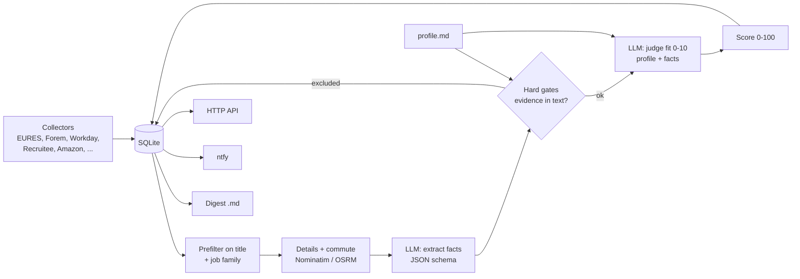

# job-scout

A personal job-search agent: it collects offers from public sources, lets a local LLM extract the facts of each
offer, applies hard gates, scores what is left, and writes a daily digest. Python, SQLite, no framework.


## Why it exists

I am looking for a first IT job in a border region (Luxembourg / Belgium / France). Job boards return hundreds of
offers a day, most of them asking for 3+ years of experience, a degree, or German. Reading them all is slow, and
asking an LLM "is this a good job for me?" directly gives inflated, unreliable answers. job-scout splits the problem:

1. the LLM only extracts **facts** from the offer (it never sees the candidate's profile, otherwise it copies the
   candidate's skills into the offer);
2. plain code applies **hard gates** (required experience, languages, degree, commute) and only trusts a claim of
   the LLM if the evidence is found in the offer text;
3. a second LLM call **judges the fit** from the profile and the extracted facts;
4. a transparent 0-100 score combines both, with every criterion visible.

## Features

- Collectors for public sources: EURES (Luxembourg and Lorraine feeds), Forem open data (Wallonia), Workday career
  pages (JSON), Recruitee, Amazon jobs, plus opt-in HTML collectors (jobs.lu, ictjob sitemap, two employer pages).
- Title prefilter without LLM (off-topic jobs, senior roles, internships, German-language ads) and job family from
  title rules.
- Commute time from a known-towns table, then Nominatim + OSRM with a SQLite cache (1 request/s).
- Grammar-constrained JSON extraction (llama.cpp `response_format: json_schema`), so the output always parses.
- Gates with evidence check: a mandatory degree, years of experience, blocked language or "students only" claim must
  be found in the offer text to exclude it.
- Optional two-model setup: a small always-on model judges by default; a bigger model on a second machine re-judges
  when that machine is idle and the model fits in VRAM (status endpoint), and is unloaded afterwards.
- Profile criteria live in a Markdown note (`profile.example.md`): change the note, not the code.
- Outputs: ntfy notifications (max one per run, none at night), a Markdown digest per day, and a small HTTP API.
- Demo mode: the whole pipeline offline, with synthetic offers and a deterministic fake LLM.

## Architecture



Score = chances of being hired (35) + interest of the job family (25) + practicality: commute and contract (10) +
judge's opinion (30).

## Quick start (demo, nothing to configure)

```sh
python -m venv .venv && . .venv/bin/activate
pip install -r requirements.txt
python -m scout demo
```

This runs the real pipeline on 10 synthetic offers (fictional employers) in a temporary directory: no network, no
LLM server, no API key. The LLM calls are answered by keyword rules (`scout/demo.py`) and the commute by a fake
table. The output is in `docs/demo-output.txt`. The same data behind the HTTP API:

```sh
SCOUT_DEMO=1 python -m scout serve        # then: curl localhost:8096/offers?min_score=50
```

Or with Docker: `SCOUT_DEMO=1 docker compose up --build`.

Note: prompts, gate reasons and judge comments are in French, because the target job market is French-speaking.
The README, code comments and digest headers are in English.

## Real use

```sh
cp profile.example.md profile.md      # describe yourself, the families you target, your commute limits
cp .env.example .env                   # point SCOUT_LLM_URL at a llama.cpp server, set SCOUT_CONTACT
set -a; . ./.env; set +a
python -m scout run                    # one pass (or: python -m scout serve for API + 4 passes a day)
```

Other commands: `digest` (rewrite today's digest), `reanalyse [min_score]` (redo the LLM extraction of rated offers
on the next run), `rejudge` (recompute gates, judgement and score from stored facts after editing the profile).

HTTP API (`serve`): `GET /offers?min_score=50&status=new,interested,applied`, `GET /stats`, `GET /health`,
`POST /status {"id": "...", "status": "interested|applied|dismissed|new"}`, `POST /run`.

## Configuration

All settings are environment variables; see `.env.example` for the full list.

| Variable | Default | Meaning |
|---|---|---|
| `SCOUT_DEMO` | empty | `1` = synthetic offers, fake LLM, fake geo table |
| `SCOUT_DATA` / `SCOUT_OUT_DIR` | `./data` / `./out` | SQLite database / daily digests |
| `SCOUT_PROFILE` | `./profile.md` | profile note (falls back to `profile.example.md`) |
| `SCOUT_LLM_URL`, `SCOUT_LLM_MODEL`, `SCOUT_LLM_KEY[_FILE]` | `http://127.0.0.1:8080/v1`, `local-model` | main OpenAI-compatible LLM |
| `SCOUT_PC_LLM_URL`, `SCOUT_PC_STATUS_URL`, `SCOUT_PC_KEY[_FILE]`, `SCOUT_PC_MODEL` | empty | optional second model (disabled when the status URL is empty) |
| `SCOUT_NTFY_URL`, `SCOUT_NTFY_TOPIC`, `SCOUT_NTFY_TOKEN` | `https://ntfy.sh`, empty | notifications (off while the topic is empty) |
| `SCOUT_SOURCES` | `eures,forem,workday,recruitee,amazon` | enabled collectors |
| `SCOUT_HOME_NAME/LAT/LON` | a small town in Lorraine | reference point for commute times |
| `SCOUT_CONTACT` | placeholder | put in the User-Agent of every request |
| `SCOUT_BIND`, `SCOUT_PORT` | `127.0.0.1`, `8096` | HTTP API |

Scoring thresholds, run hours and the EURES / Forem / Workday queries are in `scout/config.py`.

## Sources, and what it deliberately does not do

It only uses public APIs, open data and career-page JSON, at low frequency (1 s between requests, a descriptive
User-Agent with a contact address, results cached). The collectors that read HTML pages or sitemaps (jobs.lu,
ictjob, two employer career pages) are off by default: read the terms of each site before enabling them.

It deliberately does **not** scrape LinkedIn, Indeed, Stepstone, Jobat, Moovijob or Monster: their terms forbid
automated access and they actively block it. If you want them, use their e-mail alerts (an IMAP collector would be
the clean way) rather than a scraper. A France Travail API collector (free account required) is a known gap.

## Tests

```sh
pip install -r requirements-dev.txt
pytest
```

The tests cover the title prefilter, families, every gate (experience, languages, degree, students-only, commute),
the score, the engine selection logic, the ntfy payload, the HTML parsers (on small synthetic fixtures, no real
third-party page is stored) and the demo pipeline end to end (ranking, exclusion reasons, determinism).
CI runs `ruff check`, `pytest` and the demo (`.github/workflows/ci.yml`).

## Project layout

```
scout/
  __main__.py   CLI, pipeline (run / rejudge / refit), HTTP API, scheduler
  config.py     environment settings, sources, thresholds
  sources.py    collectors and HTML/JSON parsers
  families.py   job family from the title
  geo.py        commute: known towns, Nominatim + OSRM, cache
  extract.py    fact extraction (prompt + JSON schema)
  fit.py        fit judgement (prompt + JSON schema)
  score.py      prefilter, hard gates with evidence checks, 0-100 score
  engines.py    model selection, grammar-constrained chat calls
  profile.py    profile note loader (YAML frontmatter + text)
  report.py     ntfy notifications, daily digest
  db.py         SQLite schema, dedup, upsert
  demo.py       synthetic offers, fake LLM, fake geo table, demo rendering
tests/          pytest suite and synthetic HTML fixtures
profile.example.md   generic junior IT profile
```

## Status / limits

- Works for me day to day on a home server (Docker, llama.cpp), but it is a personal tool, not a product.
- The demo's fake LLM is keyword rules: it shows the pipeline and the gates, not the quality of a real model.
  The thresholds and prompts were tuned by hand on real offers with small Qwen models; nothing is benchmarked.
- Only some collectors are covered by parser tests; the JSON APIs can change without notice.
- Prompts and reasons are French only; the keyword lists of the gates cover French and English offers.
- The known-towns commute table only matches the default home town; elsewhere it falls back to Nominatim + OSRM.
- Built with AI coding assistants (Claude Code), the same way one would lean on Stack Overflow and man pages. I can
  explain every design choice above.

## Licence

MIT, see `LICENSE`.
